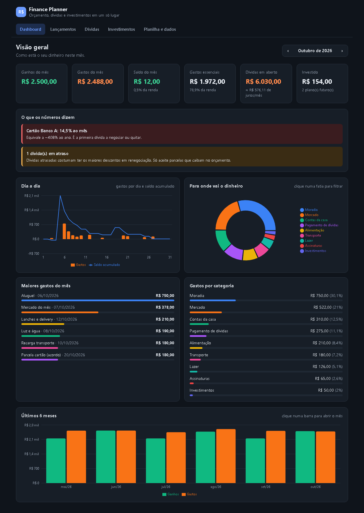
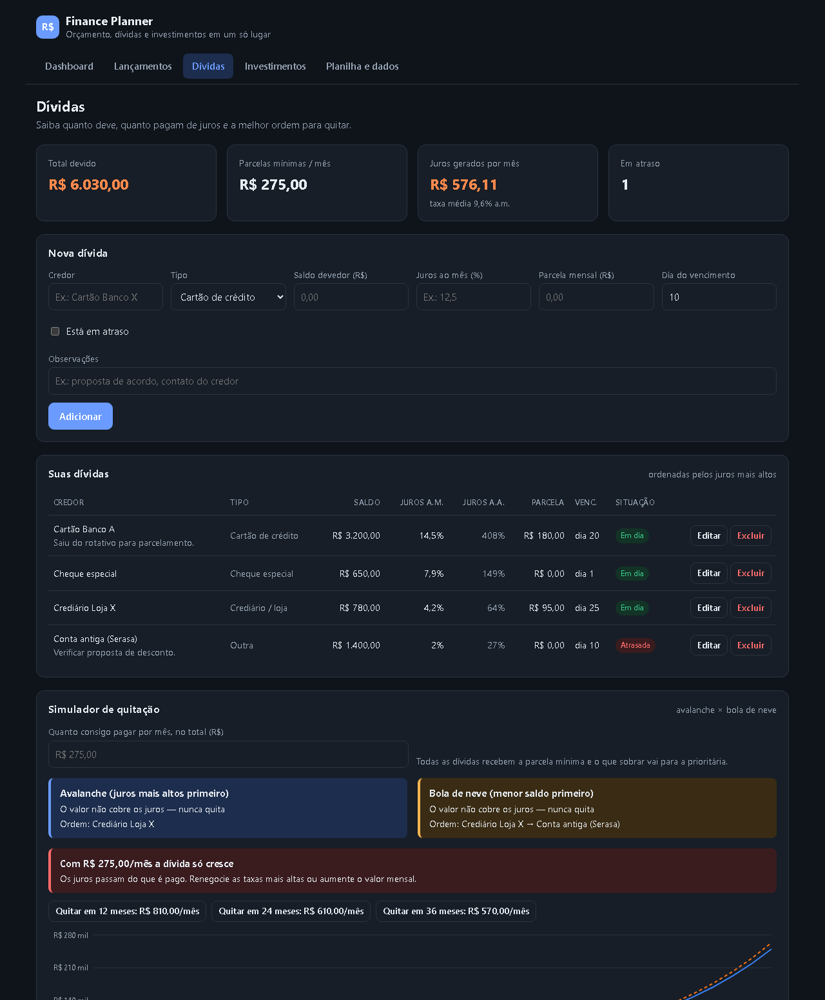
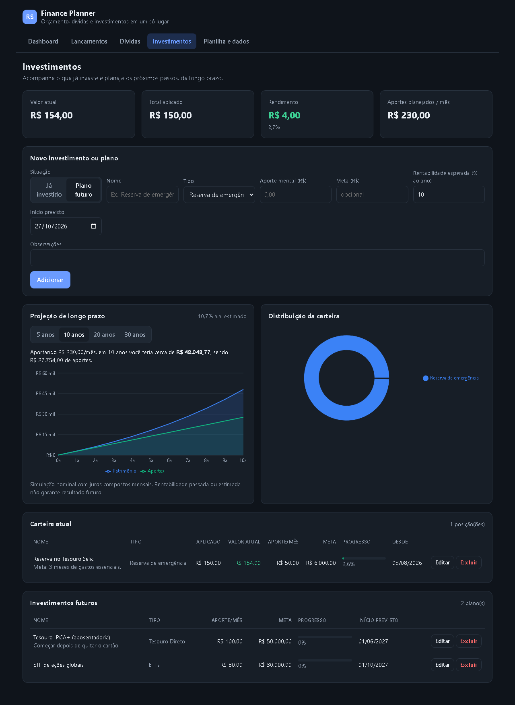

# Finance Planner · Budget, Debts & Investments Dashboard


A personal finance planner built for people on a **tight budget with debts**: log every income and expense of the day, see where the money goes, plan the cheapest way out of debt and map future long-term investments — all on an interactive dashboard that also exports a **fully automated Excel spreadsheet**.

The UI is in Brazilian Portuguese (BRL currency, `dd/mm/yyyy` dates). It runs entirely in the browser: no back-end, no sign-up, data stays on the user's device.

**[▶ Live demo](https://andresouzati.github.io/finance-planner-dashboard/?demo)** (opens with sample data)



## Features

**Dashboard**
- Monthly KPIs: income, expenses, balance, savings rate, essential spending, open debt (with monthly interest) and invested amount
- Plain-language insights: negative month, the most expensive debt (monthly rate converted to yearly), overdue debts, installments above 30% of income, biggest non-essential expense
- Daily chart with expenses per day and running balance
- Donut chart by category — **click a slice** to filter the "biggest expenses" ranking
- 6-month income × expense trend — **click a bar** to jump to that month

**Daily entries**
- Income/expense form with category, payment method (Pix, debit, credit card, cash, boleto, transfer) and Brazilian number input (`1.234,56`)
- Edit, delete, filter by type, search and month navigation

**Debts**
- Balance, monthly interest rate, equivalent yearly rate, installment, due day and overdue status
- **Payoff simulator** comparing the *avalanche* (highest rate first) and *snowball* (smallest balance first) strategies for a monthly budget: months to debt-free, total interest, payoff order and balance curve
- Budget solver (binary search) answering *"how much per month to be debt-free in 12, 24 or 36 months?"*, plus a warning when payments don't cover the interest



**Investments**
- Current positions and **planned future investments** with monthly contribution, target and expected return
- Allocation by asset class, progress toward each target
- Compound-interest projection for 5, 10, 20 or 30 years



**Automated Excel spreadsheet**
- One-click export to `.xlsx` with `Resumo` (summary), `Lançamentos`, `Dívidas` and `Investimentos` sheets
- The summary is driven by formulas (`SUMIFS`, `EOMONTH`, `EDATE`): change the reference month and every number updates — monthly KPIs, spending by category with data bars, last 12 months
- Dropdown validation for categories, types and payment methods, yearly-rate and interest formulas for debts, return and progress formulas for investments, conditional formatting for negative balances and rates above 5% a month
- Works on its own in Excel, LibreOffice or Google Sheets, and can be **imported back** (merge or replace)
- Ready-made files in [`templates/`](templates): a blank model and a filled example
- JSON backup and restore

## Tech stack

| | |
|---|---|
| **UI** | React 19, TypeScript (strict), Vite, CSS custom properties (light/dark theme) |
| **Charts** | Recharts |
| **Spreadsheet** | ExcelJS (lazy-loaded only when exporting/importing) |
| **State** | Context API + `useReducer`, persisted to `localStorage` |
| **Quality** | Vitest, ESLint, GitHub Actions (lint → test → build) |
| **Deploy** | GitHub Pages via GitHub Actions |

## Architecture

```
src/
├── types.ts              # Domain model: Transaction, Debt, Investment
├── state/                # FinanceContext (useReducer + localStorage)
├── lib/
│   ├── finance.ts        # Pure aggregations: summaries, categories, trends, insights, projections
│   ├── debtPlanner.ts    # Avalanche/snowball simulation and budget solver
│   ├── excel.ts          # Workbook builder (formulas, validation) and importer
│   ├── format.ts         # BRL/date formatting and parsing
│   ├── labels.ts         # pt-BR categories and labels
│   └── sampleData.ts     # Demo dataset
├── components/ui.tsx     # Card, KPI, month picker, form field
└── pages/                # Dashboard, Transactions, Debts, Investments, Data
```

All financial logic lives in pure functions under `src/lib`, which keeps the components thin and makes the calculations easy to unit test — including an Excel export → import round trip.

## Running locally

```bash
npm install
npm run dev        # http://localhost:5173  (add ?demo to load sample data)
```

| Script | |
|---|---|
| `npm test` | Unit tests (Vitest) |
| `npm run lint` | ESLint |
| `npm run build` | Type-check and production build |
| `npm run templates` | Regenerate the spreadsheets in `templates/` |

## Privacy

There is no server. Everything is stored in the browser's `localStorage` and only leaves the device when the user exports a file.

## License

[MIT](LICENSE)
